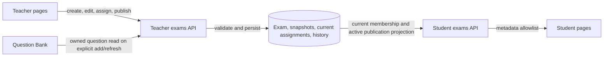

# US-EXAM-001 — Exam Authoring and Assignment

**Feature slug**: `exam-authoring-assignment`

**Delivery status**: `DEV_COMPLETE`

**Last updated**: 2026-11-27

Workflow evidence in `.specify/` is intentionally ignored by Git and remains local. The local-workflow paths below identify that evidence; application and test source links are available in this repository.

Teacher exam authoring stores an independent snapshot of selected question content, assigns the exam to current classrooms, and controls publication. Students receive only the metadata allowlist for an active publication and a classroom they currently belong to. This reference covers US-EXAM-001; it does not implement or document timed admission, attempts, or grading from US-ATT-001.

The approved behavior is recorded in the signed baseline (`.specify/features/exam-authoring-assignment/baseline.md`, local workflow), requirements (`.specify/features/exam-authoring-assignment/requirements.md`, local workflow), technical contract (`.specify/features/exam-authoring-assignment/contracts.md`, local workflow), and data model (`.specify/features/exam-authoring-assignment/data-model.md`, local workflow). Runtime paths below reflect the current source.

## Lifecycle and data flow

A teacher creates a Draft, edits settings, captures questions into exam-owned snapshots, and selects current classrooms. Publish validates the persisted settings, snapshots, assignments, and authoritative server time. A future opening produces Scheduled; the exam becomes Open at its opening boundary and Closed at its close boundary. A teacher can withdraw a publication back to Draft or close an Open exam early. The server is authoritative for lifecycle phase; timestamps and client clocks are used for display and refresh timing only.



Snapshots capture coherent source content when explicitly added. Later edits or deletion in the Question Bank do not change the captured exam content. Refresh replaces only the selected snapshot from its currently owned source; a deleted or unavailable source leaves the prior snapshot intact. Assignments represent current links; student visibility is re-evaluated against current approved classroom membership and the active publication.

The database entities are `Exam`, `ExamQuestionSnapshot`, `CurrentExamAssignment`, and `ExamActionHistory` in [`schema.prisma`](../../../apps/api/prisma/schema.prisma). Snapshot rows are independent of Question Bank row lifetime; see the [exam migration](../../../apps/api/prisma/migrations/20261127000000_exam_authoring_assignment/migration.sql).

## API reference

Responses use the existing `{data: ...}` success envelope. Exam representations are private and non-cacheable. Teacher writes to an existing exam require the current strong `If-Match` validator; a stale write returns 412 and requires a fresh read and explicit review. Child reads return `X-Exam-ETag` for the canonical exam view. The server's lifecycle projection is authoritative even when its clock sample moves backward.

| Role | Method and path | Purpose |
|---|---|---|
| Teacher | `GET /teacher/exams` | Paginated owned exam list. |
| Teacher | `POST /teacher/exams` | Create a name-only Draft; returns detail, `ETag`, and `Location`. |
| Teacher | `GET /teacher/exams/:id` | Read canonical detail and current `ETag`. |
| Teacher | `PATCH /teacher/exams/:id` | Settings, snapshot, assignment, publish, withdraw, and early-close operations; requires `If-Match`. |
| Teacher | `DELETE /teacher/exams/:id` | Delete a never-published Draft only; requires `If-Match`. |
| Teacher | `GET /teacher/exams/:id/questions` | Read the exam's ordered snapshot page. |
| Teacher | `GET /teacher/exams/:id/assignments` | Read current assigned classroom names. |
| Teacher | `GET /teacher/exams/:id/history` | Read the owning teacher's append-only action projection. |
| Student | `GET /student/exams` | Paginated metadata for qualifying active publications and current approved classes. |
| Student | `GET /student/exams/:id` | Read metadata only when current membership and active-publication checks pass. |
| Teacher | `DELETE /classrooms/:id` | Existing route; returns a typed conflict when a current link points to an ever-published exam. |

The teacher controller is [`teacher-exams.controller.ts`](../../../apps/api/src/exams/teacher-exams.controller.ts), student projection route is [`student-exams.controller.ts`](../../../apps/api/src/exams/student-exams.controller.ts), and lifecycle and persistence rules live in [`exams.service.ts`](../../../apps/api/src/exams/exams.service.ts) and [`prisma-exam.repository.ts`](../../../apps/api/src/exams/prisma-exam.repository.ts). Request validation and shared wire shapes are in [`exam-dto.ts`](../../../apps/api/src/exams/exam-dto.ts) and [`schemas.ts`](../../../apps/web/src/features/exams/schemas.ts).

### Wire and safety boundaries

- Numeric duration, attempt limit, and question count values are decimal strings on the wire, validated without JavaScript number coercion. Draft question count may be `"0"`; positive values use the full-string form `[1-9][0-9]*`.
- A password is sent only in the explicit in-memory `set` instruction or `disable` instruction. It is validated verbatim as JavaScript code units and stored only as a verifier. Responses expose `passwordRequired`, never the password or verifier; do not log password values.
- Student metadata contains exactly `title`, `teacherName`, `questionCount`, `durationMinutes`, `opensAt`, `closesAt`, `state`, `maxAttempts`, `passwordRequired`, `allowAnswerReview`, and `qualifyingClassroomNames`. The list wrapper has a separate navigation `detailPath`; metadata itself has no exam ID, answers, password verifier, or management fields. `teacherName` is the canonical display name, which may be an email-shaped fallback/display name.
- Mutation IDs correlate one explicit intent. Unknown write outcomes require a canonical read and review; do not automatically replay ambiguous creates or writes. Duplicate owned create IDs resolve with a safe owner-scoped lookup; unavailable/foreign collisions remain generic.

## Web surfaces

The router guards teacher and student routes by role in [`router.tsx`](../../../apps/web/src/app/router.tsx).

| Surface | Route | Main components |
|---|---|---|
| Teacher list | `/teacher/exams` | [`teacher-exams-page.tsx`](../../../apps/web/src/pages/teacher-exams/teacher-exams-page.tsx) |
| Teacher editor | `/teacher/exams/new`, `/teacher/exams/:id` | [`teacher-exam-editor-page.tsx`](../../../apps/web/src/pages/teacher-exams/teacher-exam-editor-page.tsx), [`draft-settings-form.tsx`](../../../apps/web/src/features/exams/teacher/draft-settings-form.tsx) |
| Question snapshots | Editor section | [`exam-question-picker.tsx`](../../../apps/web/src/features/exams/teacher/exam-question-picker.tsx), [`exam-snapshot-list.tsx`](../../../apps/web/src/features/exams/teacher/exam-snapshot-list.tsx) |
| Classroom assignment | Editor section | [`exam-assignment-editor.tsx`](../../../apps/web/src/features/exams/teacher/exam-assignment-editor.tsx) |
| Lifecycle and history | Editor section | [`exam-lifecycle-controls.tsx`](../../../apps/web/src/features/exams/teacher/exam-lifecycle-controls.tsx), [`exam-history-panel.tsx`](../../../apps/web/src/features/exams/teacher/exam-history-panel.tsx) |
| Student list/detail | `/student/exams`, `/student/exams/:id` | [`student-exams-page.tsx`](../../../apps/web/src/pages/student-exams/student-exams-page.tsx), [`student-exam-detail-page.tsx`](../../../apps/web/src/pages/student-exams/student-exam-detail-page.tsx), [`student-exam-metadata.tsx`](../../../apps/web/src/features/exams/student/student-exam-metadata.tsx) |

The editor preserves dirty input through definite failures, keeps stale or ambiguous writes locked for review, and does not silently adopt a newer validator into an older queued request. Student views display metadata and lifecycle/scheduling state; they do not offer attempt admission or grading actions.

## Verification and review status
The final applicable unit runs pass **401 tests**: 255 API tests from the unchanged backend and 146 web tests on the final frontend. Lint, typecheck and build pass. The full guarded Chromium run passes **37 E2E tests**, with the previously approved real-Google OAuth case skipped. See the whole-workspace follow-up checks (`.specify/features/exam-authoring-assignment/implementation/medium-followup-verification.json`, local workflow) and final frontend/browser checks (`.specify/features/exam-authoring-assignment/implementation/medium-focus-final-verification.json`, local workflow). All 84 final source fingerprints match the reviewed manifest (`.specify/features/exam-authoring-assignment/implementation/medium-focus-final-manifest.json`, local workflow).

Backend, shared contracts and schema were unchanged by the Medium follow-up. Their preceding 44 PostgreSQL passes (plus one conditional fixture skip, executed separately in browser setup) and 12 compiled HTTP/performance passes remain applicable. The 18-view dataset contained 5,000 exams per teacher; worst measured local p95 was 11.134 ms for teacher views and 22.208 ms for student views. These measure request dispatch through complete response, excluding rendering. Performance results (`.specify/features/exam-authoring-assignment/implementation/performance-results.json`, local workflow) · Earlier verification and fixture correction history (`.specify/features/exam-authoring-assignment/implementation/round3-verification-results.json`, local workflow).

Final code review is **APPROVE** and UI review is **PASS**. All five follow-up findings—REL-001, REL-004, REL-007, UI-009 and UI-010—are resolved, with no open Critical, High or Medium findings in the reviewed scope. Round 4 independently verified review locks, assignment cursor recovery, pending history/snapshot reads and create-title comparison. Round 5 verified event-specific validation focus; the resumed independent 1024 px Chromium probe confirmed repeated invalid submission focuses Duration, ordinary title typing retains focus and numeric values, and no PATCH is sent. Code review (`.specify/features/exam-authoring-assignment/implementation/review-round5-report.md`, local workflow) · UI review and screenshots (`.specify/features/exam-authoring-assignment/implementation/ui-review-round5-report.md`, local workflow) · Resolution history (`.specify/features/exam-authoring-assignment/CHANGELOG.md#five-medium-resolution`, local workflow).

This is `DEV_COMPLETE`. The evidence does not establish exhaustive runtime coverage for every acceptance criterion, WCAG certification, other browser engines, or production verification. Database-backed tests—including the existing API unit suite—require an explicit disposable database URL and identity verification; use the guarded launcher and verification helpers rather than the default project database.

Test traceability is recorded in the acceptance evidence map (`.specify/features/exam-authoring-assignment/implementation/acceptance-evidence-map.md`, local workflow), signed traceability matrix (`.specify/features/exam-authoring-assignment/traceability-matrix.md`, local workflow) and approved verification plan (`.specify/features/exam-authoring-assignment/plan.md`, local workflow). Relevant tests include [`exam-writes.exam-db.spec.ts`](../../../apps/api/verification/exam-writes.exam-db.spec.ts), [`student-exams.exam-db.spec.ts`](../../../apps/api/verification/student-exams.exam-db.spec.ts), [`exam-recovery-regressions.spec.ts`](../../../apps/web/e2e/exam-recovery-regressions.spec.ts) and [`use-draft-editor.spec.ts`](../../../apps/web/src/features/exams/teacher/use-draft-editor.spec.ts).

### Repeat guarded browser verification
Run from the repository root with an owned disposable PostgreSQL16 URL whose database marker matches the verification contract:

```sh
EXAM_VERIFY_DATABASE_URL="${EXAM_VERIFY_DATABASE_URL:?Set the disposable test URL}" \
  node apps/web/e2e/run-exam-verification.mjs
```

The launcher verifies the database identity, PostgreSQL major version, free ports and private fixture marker before using the test application. It supplies the same explicit target to both application and fixture setup. The approved plan (`.specify/features/exam-authoring-assignment/plan.md`, local workflow) records the broader verification prerequisites.

## Scope boundary

This feature owns exam creation, teacher-controlled settings, question snapshots, current classroom assignment, publication lifecycle, history, and student metadata visibility. Timed attempt admission, answer submission, grading, and result disclosure belong to US-ATT-001 and are excluded here.

## Authorized Medium follow-up
On 2026-11-27 the user authorized fixing all five Medium findings and additional review rounds. Rounds 4 and 5 closed those findings. The shared five-hour quota stopped the optional independent final probe before startup; after the user resumed and usage was available, that probe passed. Signed business scope remained unchanged; previous conditional results remain archived.
