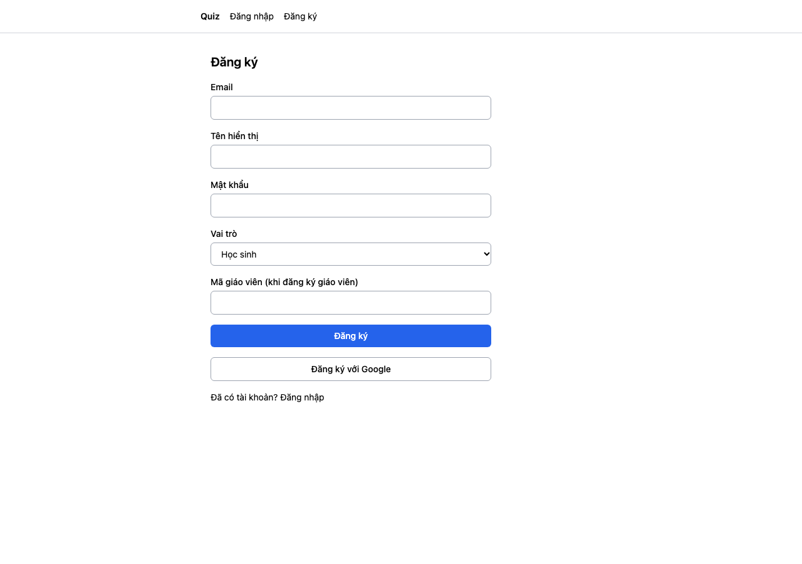
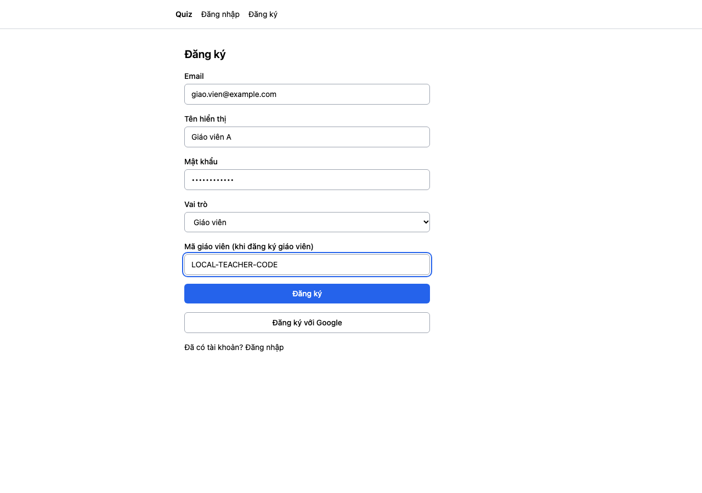
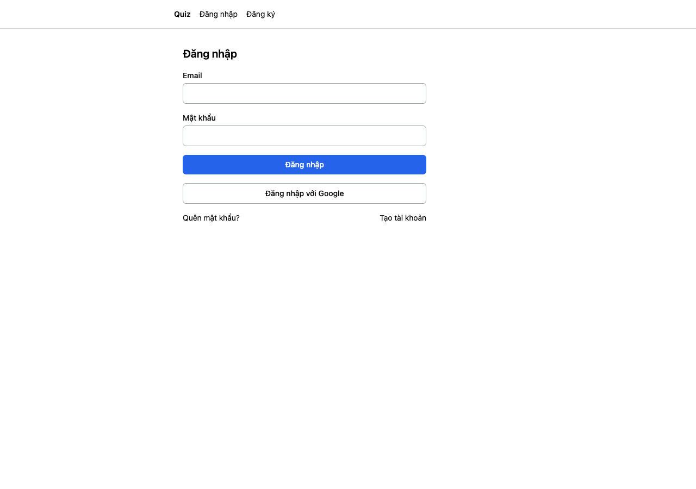
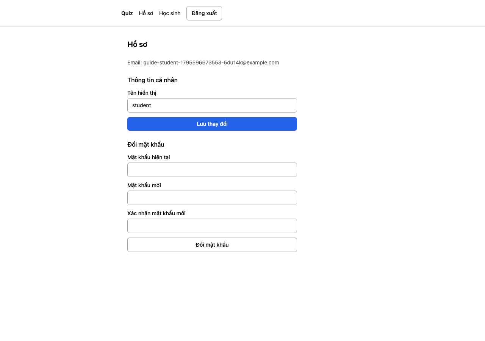
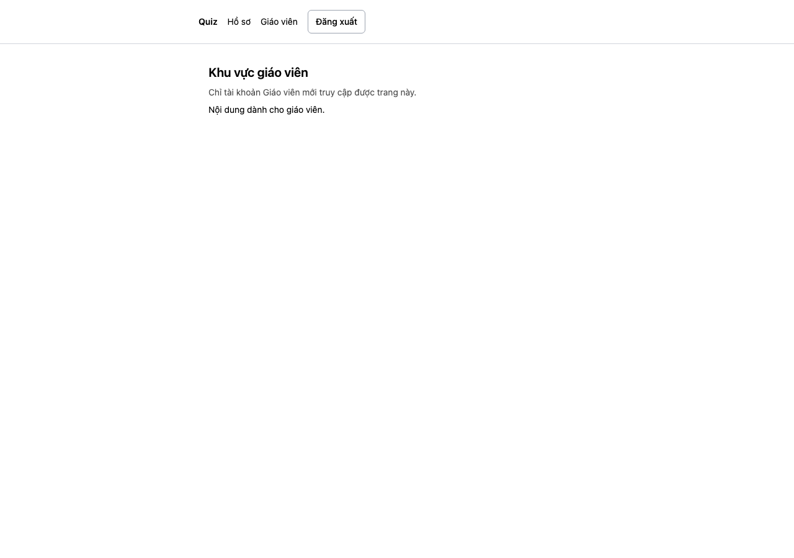
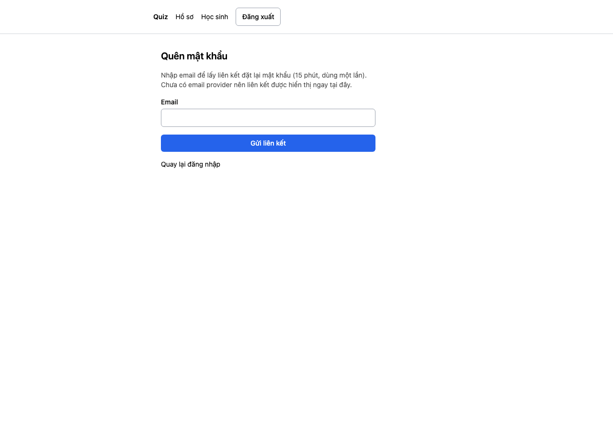
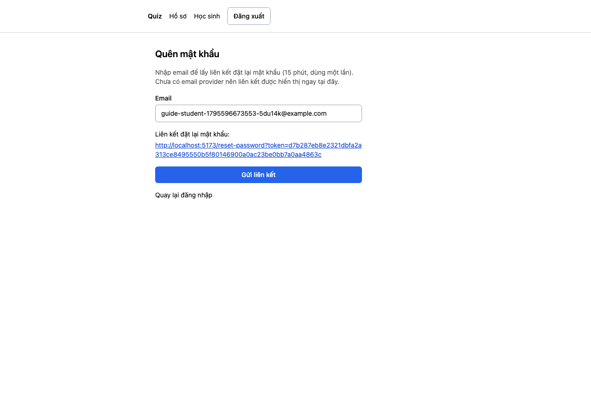
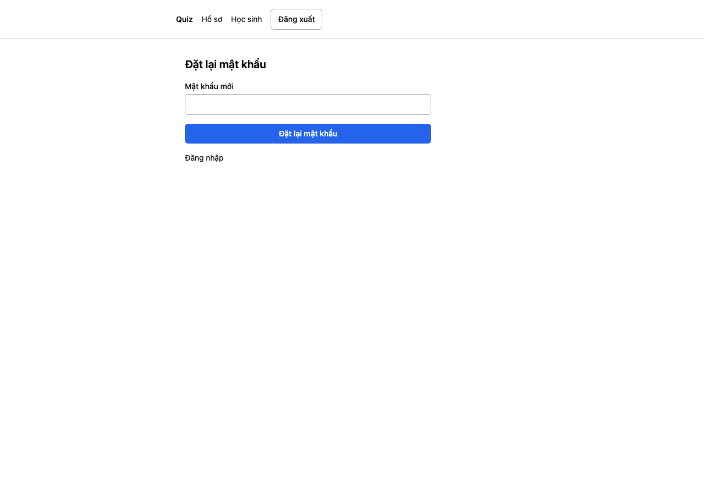
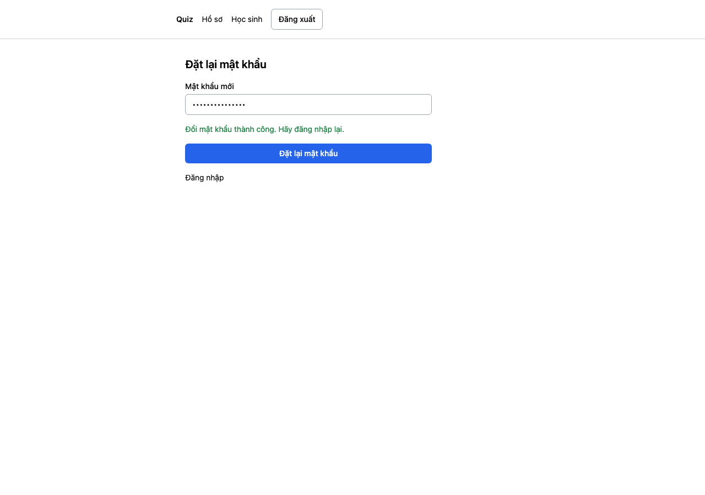

# Hướng dẫn sử dụng: Xác thực và phân quyền nền tảng (US-AUTH-001)

Tài liệu này mô tả cách sử dụng các tính năng đăng ký, đăng nhập, hồ sơ, khu vực theo vai trò và khôi phục mật khẩu của ứng dụng web thi trắc nghiệm. Tất cả ảnh chụp trong tài liệu được **chụp thật bằng Playwright/Chromium** chạy trên ứng dụng thật (`http://localhost:5173`) với API thật (`http://localhost:3000`) và PostgreSQL thật — không phải ảnh dựng hoặc ảnh mock. Các tài khoản trong ảnh là tài khoản thử nghiệm được tạo với email sinh ngẫu nhiên trong cơ sở dữ liệu local.

## 1. Chuẩn bị môi trường

```bash
pnpm db:up          # khởi động PostgreSQL (Docker)
pnpm db:migrate     # áp dụng migration Prisma
pnpm dev            # khởi động API (:3000) và web (:5173)
```

Kiểm tra nhanh: `curl http://localhost:3000/health` phải trả về `{"status":"ok","database":"connected",...}`.

Mã giáo viên dùng trong môi trường local lấy từ biến `TEACHER_CODE` trong file `.env` (mặc định `LOCAL-TEACHER-CODE`). Giá trị hiển thị trong ảnh chụp chỉ là giá trị phát triển local; ở môi trường khác hãy dùng mã do quản trị viên cung cấp.

## 2. Đăng ký tài khoản

Truy cập `/register` hoặc bấm **Đăng ký** trên thanh điều hướng / trang chủ.



Điền đầy đủ:

| Trường | Bắt buộc | Ghi chú |
| :--- | :--- | :--- |
| Email | Có | Phải là địa chỉ email hợp lệ và chưa tồn tại. |
| Tên hiển thị | Có | Tên hiển thị sau khi đăng nhập. |
| Mật khẩu | Có | Tuân thủ quy tắc mật khẩu mạnh của form. |
| Vai trò | Có | Chỉ có hai lựa chọn: **Học sinh** (`STUDENT`) hoặc **Giáo viên** (`TEACHER`). |
| Mã giáo viên | Có khi chọn Giáo viên | Đối chiếu với `TEACHER_CODE` đã cấu hình. |



Sau khi bấm **Đăng ký**, hệ thống chuyển về trang đăng nhập. Các lỗi thường gặp:

- `EMAIL_IN_USE` (HTTP 409): email đã được đăng ký.
- `INVALID_TEACHER_CODE` (HTTP 400): mã giáo viên sai, hoặc bạn chọn `STUDENT` nhưng lại nhập mã giáo viên (sự hiện diện của mã được coi là yêu cầu quyền giáo viên).
- `VALIDATION_ERROR` (HTTP 400): dữ liệu không hợp lệ, ví dụ vai trò `ADMIN` — vai trò này **không tồn tại** trong hệ thống.

Bạn cũng có thể bấm **Đăng ký với Google**; xem mục [Kiểm thử Google thật](#7-kiểm-thử-e2e-google-thật-opt-in) để biết cách chạy luồng này.

## 3. Đăng nhập

Truy cập `/login`, nhập Email và Mật khẩu rồi bấm **Đăng nhập**.



- Đăng nhập thành công sẽ điều hướng tới `/student` hoặc `/teacher` tùy vai trò của tài khoản.
- Nhấn **Quên mật khẩu?** để đi tới luồng khôi phục (mục 5).
- Nhấn **Tạo tài khoản** để quay lại trang đăng ký.
- Nút **Đăng nhập với Google** thực hiện luồng xác thực Google thật (xem mục 7).

Sai thông tin đăng nhập trả về `INVALID_CREDENTIALS` (HTTP 401). Phiên đăng nhập gồm access token lưu trong bộ nhớ ứng dụng và refresh token đặt trong cookie httpOnly tại đường dẫn `/auth`; phiên được khôi phục tự động khi tải lại trang.

## 4. Hồ sơ cá nhân

Sau khi đăng nhập, bấm **Hồ sơ** trên thanh điều hướng hoặc truy cập `/profile`.



Trang có hai phần:

1. **Thông tin cá nhân**: thay đổi **Tên hiển thị** rồi bấm **Lưu thay đổi**. Thông báo `Cập nhật hồ sơ thành công.` xuất hiện khi lưu xong.
2. **Đổi mật khẩu**: nhập **Mật khẩu hiện tại**, **Mật khẩu mới** và **Xác nhận mật khẩu mới** rồi bấm **Đổi mật khẩu**. Thao tác này thu hồi tất cả refresh token và vô hiệu hóa access token hiện tại, vì vậy hệ thống tự động đưa bạn về `/login` để đăng nhập lại bằng mật khẩu mới. Mật khẩu cũ không còn dùng được.

Sai mật khẩu hiện tại trả về `INVALID_CREDENTIALS` (HTTP 401).

## 5. Khu vực theo vai trò

Hệ thống chỉ có hai vai trò: `STUDENT` (**Học sinh**) và `TEACHER` (**Giáo viên**). Không có vai trò `ADMIN`, kể cả ẩn.

- Tài khoản Học sinh truy cập `/student`:

  

- Tài khoản Giáo viên truy cập `/teacher`:

  

Hành vi bảo vệ:

- Chưa đăng nhập mà truy cập `/profile`, `/student` hoặc `/teacher` → chuyển hướng về `/login`.
- Đăng nhập bằng tài khoản Học sinh rồi mở `/teacher` → bị chuyển về trang chủ; ngược lại cũng vậy.
- Thanh điều hướng chỉ hiển thị liên kết phù hợp với vai trò hiện tại (**Học sinh** hoặc **Giáo viên**).
- Với API, tài nguyên ngoài phạm vi vai trò trả về `403` (không phải `404`) để không tiết lộ sự tồn tại của tài nguyên.
- Đăng nhập qua Google đi chung một cơ chế gán vai trò: mã giáo viên chỉ được xét khi đăng ký tài khoản mới; liên kết Google với email đã tồn tại **không** nâng cấp quyền của tài khoản đó.

Nhấn **Đăng xuất** trên thanh điều hướng để kết thúc phiên; mọi access token và refresh token cũ đều bị vô hiệu hóa.

## 6. Khôi phục và đặt lại mật khẩu

### 6.1 Quên mật khẩu

Truy cập `/forgot-password` hoặc bấm **Quên mật khẩu?** từ trang đăng nhập/trang chủ.



Nhập email và bấm **Gửi liên kết**.

Do stack hiện tại chưa có nhà cung cấp email/SMTP, liên kết đặt lại **được hiển thị ngay trên trang** và được ghi log phía server (quyết định D-AUTH-01). Việc gửi email production là hạng mục làm tiếp theo, chưa được triển khai.



Liên kết có dạng `/reset-password?token=...`, có hiệu lực **15 phút** và **dùng được một lần**.

### 6.2 Đặt lại mật khẩu

Mở liên kết nhận được (trang `/reset-password?token=...`), nhập **Mật khẩu mới** rồi bấm **Đặt lại mật khẩu**.





Sau khi thành công, đăng nhập lại bằng mật khẩu mới. Mật khẩu cũ bị từ chối (`INVALID_CREDENTIALS`, HTTP 401). Nếu mở lại liên kết đã dùng hoặc liên kết đã hết hạn, API trả về `INVALID_RESET_TOKEN` (HTTP 400) và form báo lỗi tương ứng. Việc đặt lại mật khẩu cũng thu hồi refresh token và vô hiệu hóa các access token cũ.

## 7. Kiểm thử E2E Google thật (opt-in)

Luồng Google OAuth được kiểm thử bằng **Google thật**, không giả lập. Tuy nhiên màn hình xác nhận (consent) của Google mang tính tương tác, không chạy được trong CI headless, nên spec `apps/web/e2e/oauth-google.spec.ts` bị **bỏ qua mặc định**. Bộ E2E CI thông thường (`pnpm test:e2e`) vẫn chạy deterministic và phủ toàn bộ tiêu chí không liên quan tới OAuth.

Để chạy luồng Google thật trên máy local:

```bash
# Khởi động API + web + Postgres như mục 1, sau đó:
E2E_GOOGLE_EMAIL="tai-khoan-google@example.com" \
E2E_GOOGLE_PASSWORD="mat-khau-google" \
pnpm --filter web test:e2e:google
```

Script `test:e2e:google` trong `apps/web/package.json` đã thiết lập `E2E_GOOGLE_REAL=1` và chạy `playwright test e2e/oauth-google.spec.ts --headed` (cần trình duyệt có giao diện). Có thể gọi trực tiếp tương đương:

```bash
E2E_GOOGLE_REAL=1 E2E_GOOGLE_EMAIL=... E2E_GOOGLE_PASSWORD=... \
  pnpm --filter web exec playwright test e2e/oauth-google.spec.ts --headed
```

Điều kiện cần:

- `OAUTH_GOOGLE_CLIENT_ID` và `OAUTH_GOOGLE_CLIENT_SECRET` trong `.env` phải là thông tin của một ứng dụng Google OAuth thật, với redirect URI trỏ về local app. Giá trị `local-client-id` / `local-client-secret` trong `.env` mẫu chỉ dùng để chạy bộ test mặc định (không gọi Google).
- Biến `E2E_GOOGLE_REAL=1` và cặp `E2E_GOOGLE_EMAIL` / `E2E_GOOGLE_PASSWORD`. Thiếu một trong hai giá trị cuối → test bị skip.
- Chế độ `--headed` để thao tác trên màn hình consent của Google. Nếu tài khoản bật xác thực hai yếu tố (2FA), hãy hoàn tất bước đó bằng tay trong cửa sổ trình duyệt; selector trong spec là "best effort" và có thể cần điều chỉnh theo giao diện Google hiện tại.

Luồng test kiểm tra: từ `/login`, bấm **Đăng nhập với Google** → điều hướng tới `accounts.google.com` → hoàn tất consent → Google chuyển về `/oauth/callback?code=...&state=...` → SPA gọi `POST /auth/oauth/google/callback` → đăng nhập thành công và tới `/student` hoặc `/teacher`. Nếu bạn nhập mã giáo viên trước khi bấm nút Google trên trang đăng ký, mã đó được giữ trong `sessionStorage` và gửi cùng callback để áp dụng cho tài khoản Google **mới** — cơ chế này không bao giờ nâng quyền tài khoản đã tồn tại.

> Lưu ý: Google OAuth chỉ nằm trong phạm vi MVP. Việc đăng ký client Google cho domain production và gửi email reset links production vẫn là hạng mục mở (ASM-AUTH-004 / ASM-BACKLOG-07).

## 8. Bảng mã lỗi thường gặp

| Mã | HTTP | Ngữ cảnh |
| :--- | :--- | :--- |
| `VALIDATION_ERROR` | 400 | Dữ liệu form/API không hợp lệ (email sai định dạng, vai trò không hợp lệ…). |
| `INVALID_TEACHER_CODE` | 400 | Mã giáo viên sai hoặc khai báo trái với vai trò đã chọn. |
| `INVALID_RESET_TOKEN` | 400 | Liên kết đặt lại hết hạn (15 phút) hoặc đã được dùng. |
| `INVALID_CREDENTIALS` | 401 | Sai email/mật khẩu, sai mật khẩu hiện tại, hoặc token đã bị thu hồi. |
| `EMAIL_IN_USE` | 409 | Email đã tồn tại khi đăng ký. |
| — | 403 | Truy cập tài nguyên ngoài phạm vi vai trò. |

## 9. Danh sách ảnh chụp

| File | Nội dung |
| :--- | :--- |
| `screenshots/register.png` | Form đăng ký trống tại `/register`. |
| `screenshots/register-teacher-role.png` | Form đăng ký với vai trò Giáo viên và mã giáo viên. |
| `screenshots/login.png` | Form đăng nhập tại `/login`. |
| `screenshots/profile.png` | Trang hồ sơ sau khi đăng nhập bằng tài khoản Học sinh. |
| `screenshots/student-area.png` | Khu vực `/student` của tài khoản Học sinh. |
| `screenshots/teacher-area.png` | Khu vực `/teacher` của tài khoản Giáo viên. |
| `screenshots/forgot-password.png` | Form quên mật khẩu tại `/forgot-password`. |
| `screenshots/forgot-password-reset-link.png` | Liên kết đặt lại dùng một lần hiển thị sau khi gửi yêu cầu. |
| `screenshots/reset-password.png` | Form đặt lại mật khẩu với token hợp lệ. |
| `screenshots/reset-password-success.png` | Thông báo đặt lại mật khẩu thành công. |
