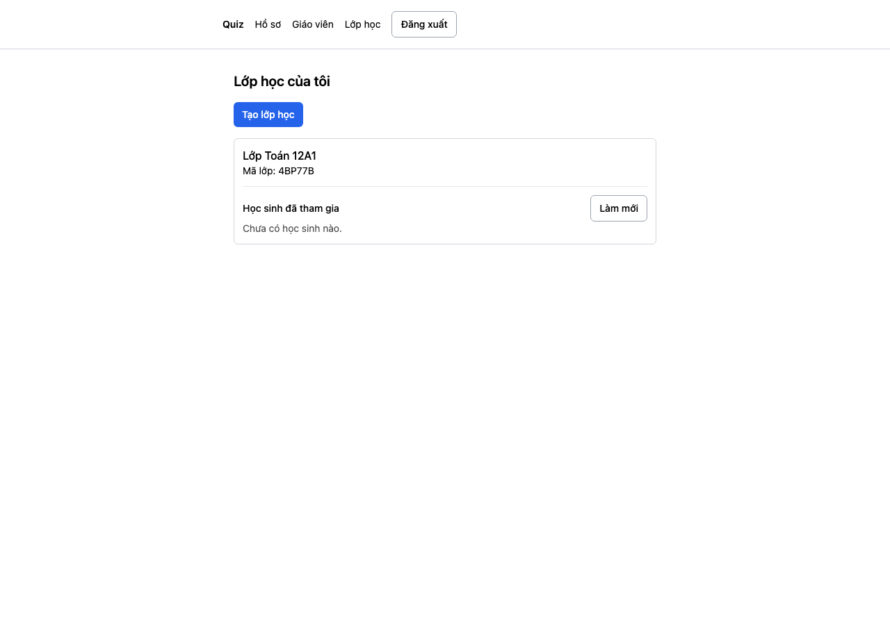
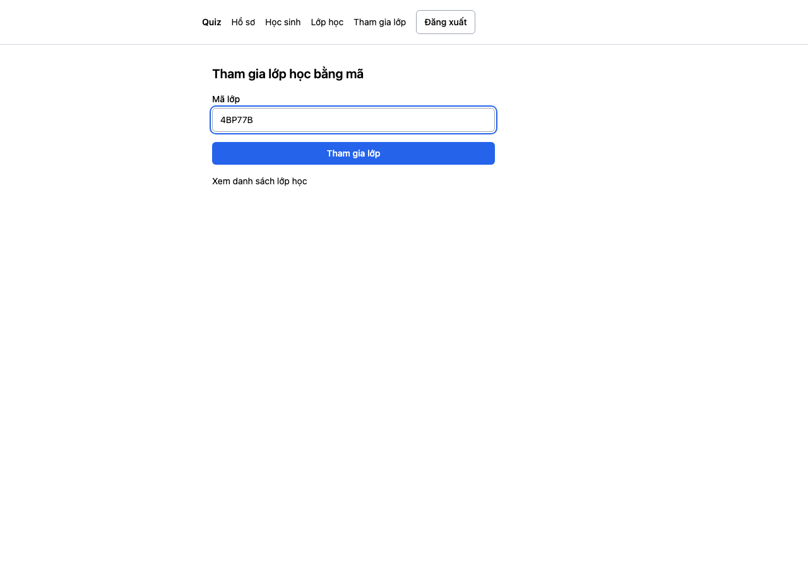
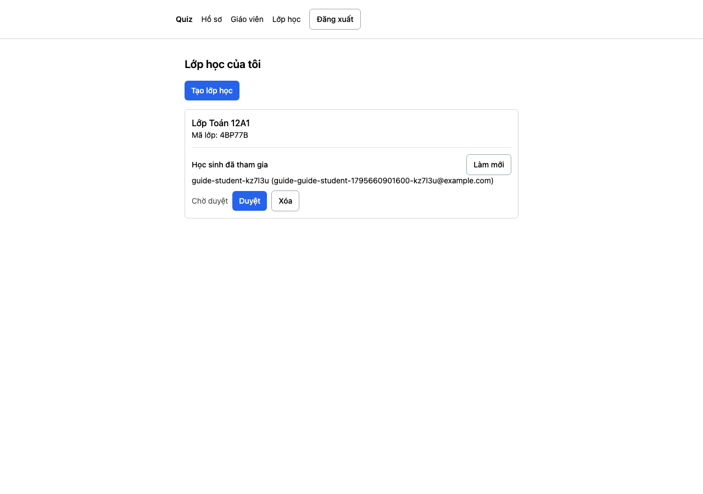
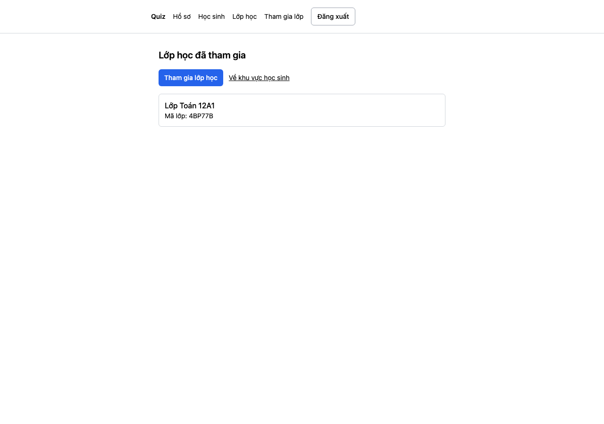

# Hướng dẫn sử dụng: Lớp học và mã tham gia (US-CLS-001)

Tài liệu mô tả cách giáo viên tạo lớp, chia mã lớp và duyệt học sinh; cách học sinh tham gia bằng mã. Tất cả ảnh chụp được **chụp thật bằng Playwright/Chromium** trên ứng dụng thật (`http://localhost:5173`), API thật (`http://localhost:3000`) và PostgreSQL thật — không phải ảnh dựng hoặc mock.

## 1. Chuẩn bị

```bash
corepack pnpm db:up          # PostgreSQL 16 trong Docker
corepack pnpm db:migrate     # áp dụng migration, gồm 20261126093000_add_classrooms
corepack pnpm dev            # API :3000 và web :5173
```

Cần có tài khoản Giáo viên (đăng ký với `TEACHER_CODE` hợp lệ) và tài khoản Học sinh. Xem hướng dẫn xác thực tại [`auth-role-foundation.md`](./auth-role-foundation.md).

## 2. Giáo viên tạo lớp

Vào **Khu vực giáo viên → Quản lý lớp học** hoặc truy cập `/teacher/classrooms`.



1. Bấm **Tạo lớp học**.
2. Nhập tên lớp, bấm **Tạo lớp**. Form là phần mở rộng ngay trên trang (không phải hộp thoại chặn màn hình); nhấn `Escape` để đóng, focus tự chuyển vào form khi mở.
3. Mỗi lớp nhận một mã gồm **6 ký tự chữ cái in hoa hoặc số**, ví dụ `4BP77B`. Mã này là duy nhất và không thay đổi trong suốt vòng đời lớp.

Chia mã cho học sinh qua bất kỳ kênh nào bạn dùng trong lớp học. Hệ thống MVP không gửi thông báo tự động.

## 3. Học sinh tham gia bằng mã

Vào **Khu vực học sinh → Tham gia lớp học bằng mã** hoặc truy cập `/student/join`.



- Nhập đúng 6 ký tự. Chữ thường được tự động chuyển sang chữ hoa.
- Sau khi bấm **Tham gia lớp**, hệ thống báo đã gửi yêu cầu và cần chờ giáo viên duyệt.
- Ở giai đoạn này, lớp **chưa xuất hiện** trong danh sách lớp đã tham gia của học sinh.

Lỗi thường gặp:

| Mã lỗi | HTTP | Nguyên nhân |
| :-- | :-- | :-- |
| `CLASS_CODE_NOT_FOUND` | 404 | Mã lớp không tồn tại hoặc gõ sai. |
| `VALIDATION_ERROR` | 400 | Mã không đúng 6 ký tự chữ/số. |
| `UNAUTHORIZED` / `FORBIDDEN` | 401 / 403 | Chưa đăng nhập hoặc dùng tài khoản Giáo viên để tham gia. |

## 4. Giáo viên duyệt hoặc xóa học sinh

Trong `/teacher/classrooms`, mỗi lớp có phần **Học sinh đã tham gia**. Bấm **Làm mới** để cập nhật danh sách.



- Trạng thái **Chờ duyệt**: bấm **Duyệt** để phê duyệt.
- Trạng thái **Đã duyệt**: nút Duyệt biến mất; vẫn có nút **Xóa** để đưa học sinh ra khỏi lớp.
- Xóa lớp sẽ xóa luôn mã lớp và toàn bộ yêu cầu tham gia của lớp đó.

Giáo viên chỉ thấy lớp do chính mình tạo. Truy cập trực tiếp lớp của giáo viên khác (kể cả qua URL) trả về `FORBIDDEN`.

## 5. Học sinh xem lớp đã được duyệt

Sau khi giáo viên bấm **Duyệt**, học sinh tải lại `/student/classrooms`.



Học sinh chỉ thấy các lớp có yêu cầu đã được duyệt. Bài luyện tập, đề thi và chấm điểm sẽ được xây dựng trên các lớp này ở các use case tiếp theo.
