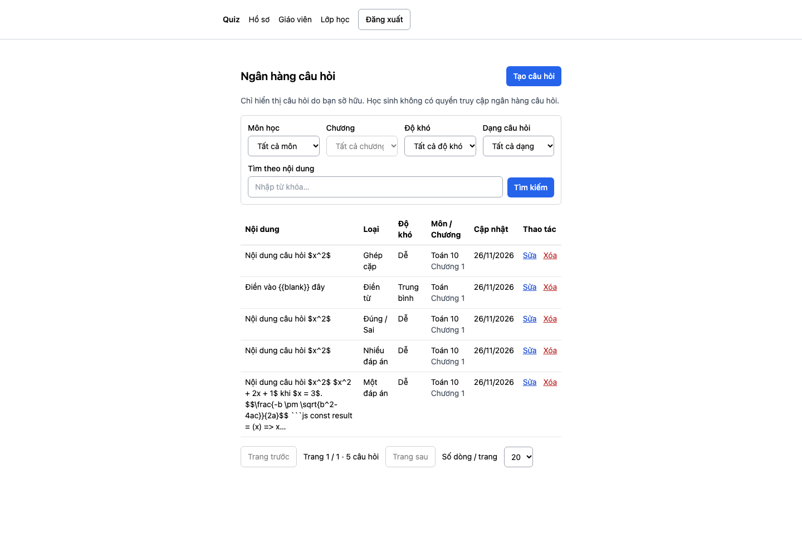
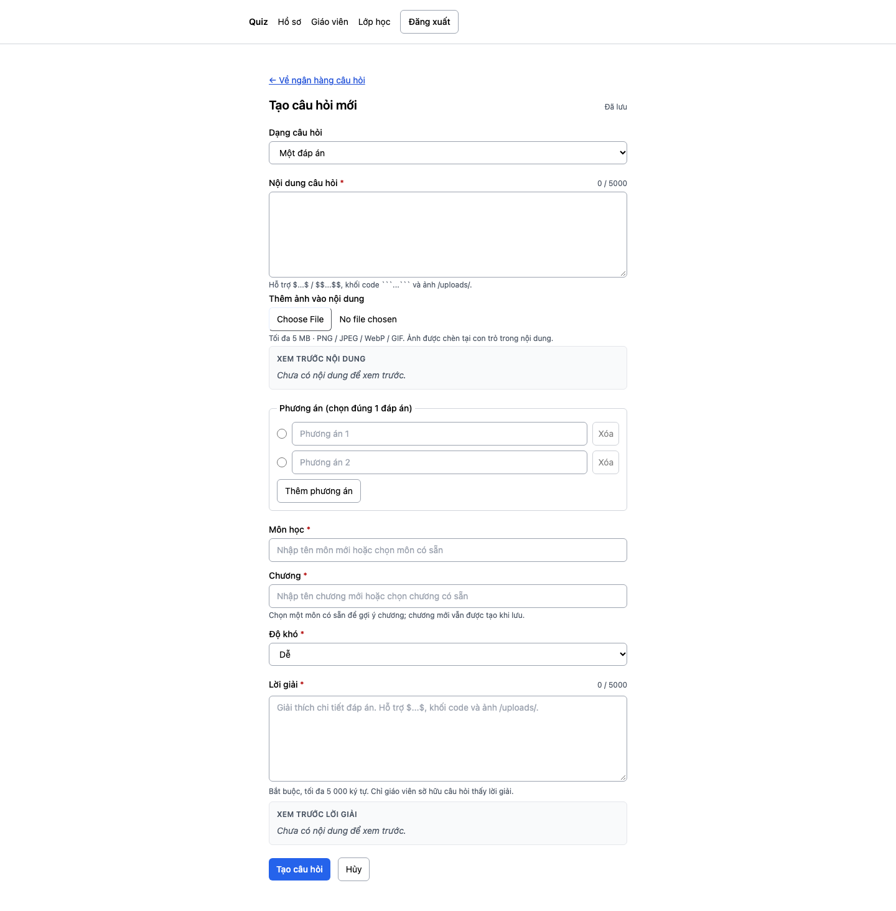
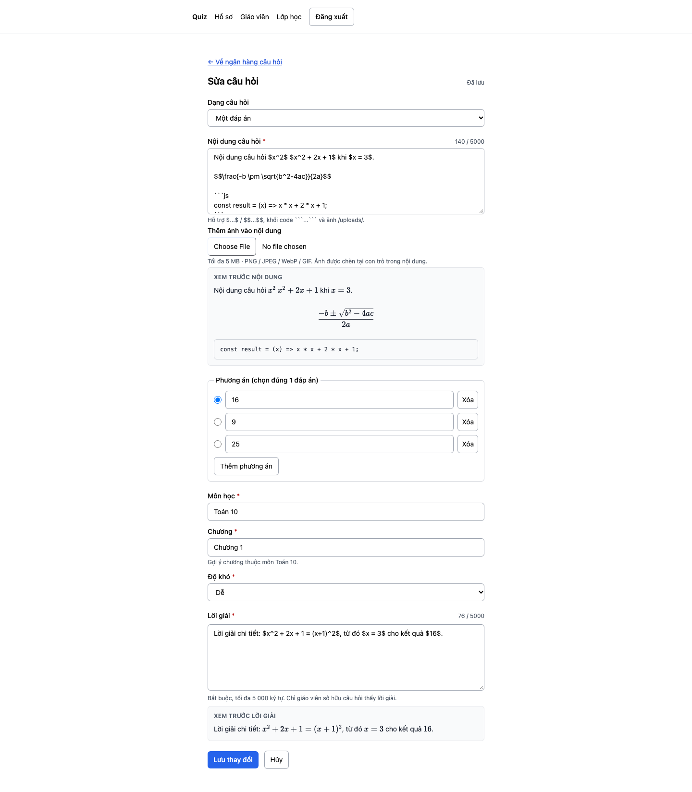
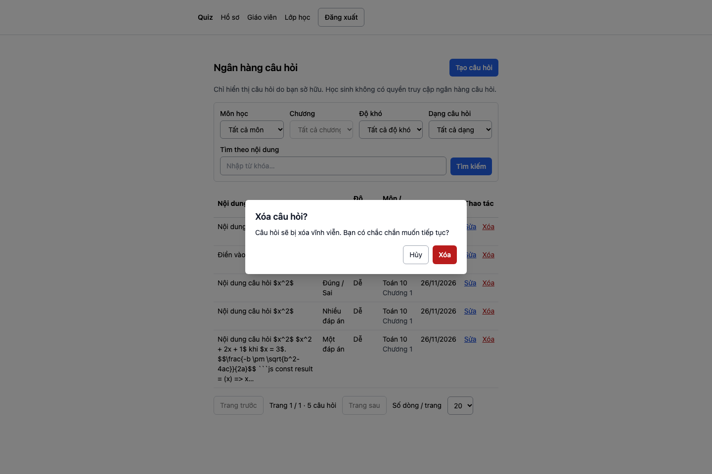
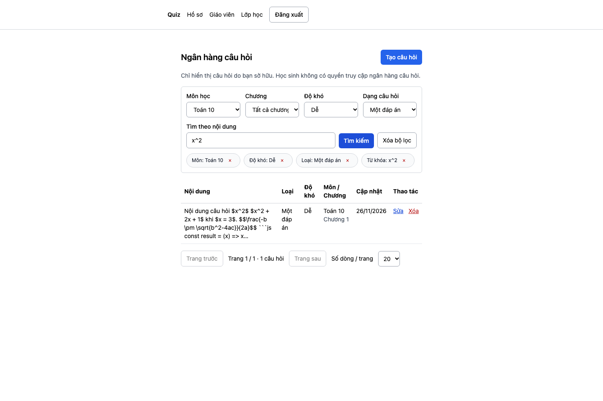

# Hướng dẫn sử dụng: Ngân hàng câu hỏi (US-QB-001)

Tài liệu hướng dẫn giáo viên tạo, sửa, xóa, lọc và phân trang câu hỏi trong ngân hàng câu hỏi. Tất cả ảnh chụp được **chụp thật bằng Playwright/Chromium** trên ứng dụng thật (`http://localhost:5173`) với dữ liệu thật — không phải ảnh dựng hay mock.

## 1. Truy cập ngân hàng câu hỏi

Vào **Giáo viên → Ngân hàng câu hỏi** hoặc truy cập `/teacher/questions`.



1. Trang chỉ liệt kê **câu hỏi do chính bạn sở hữu**. Cột **Nội dung** hiển thị tóm tắt, các cột **Loại**, **Độ khó**, **Môn / Chương**, **Cập nhật** giúp nhận diện nhanh.
2. Ở đầu trang có nút **Tạo câu hỏi**; mỗi dòng có liên kết **Sửa** và nút **Xóa**.
3. **Chỉ giáo viên mới truy cập được.** Học sinh không có liên kết tới ngân hàng; nếu cố mở trực tiếp địa chỉ trang, hệ thống sẽ đưa về trang chủ. Giáo viên cũng không xem hoặc chỉnh sửa được câu hỏi của giáo viên khác.

## 2. Tạo câu hỏi mới

Bấm **Tạo câu hỏi** trên trang danh sách, hoặc truy cập `/teacher/questions/new`.



1. Chọn **Dạng câu hỏi** ở danh sách thả xuống đầu trang.
2. Nhập **Nội dung câu hỏi** (bắt buộc, tối đa 5 000 ký tự).
3. Khai báo **Môn học**, **Chương**, **Độ khó** trong nhóm **Phân loại câu hỏi** (xem mục 3).
4. Điền phần đáp án tương ứng với dạng đã chọn (xem bảng dưới đây).
5. Nhập **Lời giải** (bắt buộc — xem mục 4).
6. Bấm **Tạo câu hỏi**. Sau khi lưu, hệ thống quay lại danh sách và hiện thông báo **Đã lưu câu hỏi.**

Nếu bạn đổi dạng khi đã nhập đáp án, một hộp xác nhận **Đổi dạng câu hỏi?** hiện lên: các đáp án riêng của dạng cũ sẽ bị xóa, còn nội dung, phân loại và lời giải được giữ lại. Bấm **Hủy** để giữ nguyên.

### Năm dạng câu hỏi

| Dạng | Cách nhập đáp án |
| :-- | :-- |
| **Một đáp án** | Nhập ít nhất 2 phương án (tối đa 10), chọn đúng 1 bằng nút tròn. |
| **Nhiều đáp án** | Nhập ít nhất 2 phương án (tối đa 10), chọn ít nhất 2 nút tròn làm đáp án đúng. |
| **Đúng / Sai** | Chọn **Đúng** hoặc **Sai**. Không cần nhập phương án. |
| **Điền từ** | Nội dung phải có **đúng một** chỗ trống `{{blank}}` (nút chèn sẵn trong biểu mẫu). Nhập ít nhất 1 đáp án chấp nhận, tối đa 10; các đáp án không được trùng nhau. |
| **Ghép cặp** | Nhập ít nhất 2 cặp (tối đa 10). Vế trái và vế phải đều bắt buộc và không được trùng nhau. |

Các phương án và đáp án **không được trùng nhau** (không phân biệt chữ hoa/thường và khoảng trắng thừa). Lời giải bị để trống hoặc toàn dấu cách sẽ bị từ chối.

## 3. Phân loại: Môn học, Chương, Độ khó

- **Môn học** và **Chương** là ô nhập tự do, có gợi ý từ các môn/chương đã có. Bạn có thể gõ tên mới; tên mới sẽ được tạo khi lưu câu hỏi. Thay đổi môn học sẽ xóa chương đã chọn.
- **Độ khó** gồm 3 mức: **Dễ**, **Trung bình**, **Khó**.
- Ba trường này đều bắt buộc và hiển thị trên từng dòng của danh sách, đồng thời dùng làm điều kiện lọc.

## 4. Nội dung toán học, ảnh, mã nguồn và lời giải

Nội dung và lời giải hỗ trợ:

- Công thức toán học viết giữa `$...$` (trong một dòng) hoặc `$$...$$` (căn giữa, chiếm một đoạn riêng).
- Khối mã nguồn đặt giữa hai dòng ``` (ba dấu backtick).
- Ảnh PNG, JPEG, WebP hoặc GIF, tối đa **5 MB**. Chọn ảnh trong phần **Thêm ảnh vào nội dung**: ảnh được tải lên và chèn ngay tại vị trí con trỏ trong ô nội dung.

Ô **Xem trước nội dung** và **Xem trước lời giải** hiển thị kết quả ngay khi bạn rời khỏi ô nhập, giúp kiểm tra công thức và mã nguồn trước khi lưu.



**Quy tắc lời giải:** lời giải là bắt buộc, tối đa 5 000 ký tự, và **chỉ giáo viên sở hữu câu hỏi mới nhìn thấy**. Đây là phần giải thích chi tiết tại sao đáp án đúng — không phải chỉ gõ đáp án.

## 5. Sửa câu hỏi

Trong danh sách, bấm **Sửa** trên dòng cần chỉnh. Trình soạn mở ở chế độ **Sửa câu hỏi** với toàn bộ nội dung, dạng, đáp án, phân loại và lời giải có sẵn.

1. Thay đổi thông tin cần thiết, rồi bấm **Lưu thay đổi**.
2. Nếu đang có thay đổi chưa lưu và bạn bấm **Hủy** hoặc rời khỏi trang, hệ thống sẽ hỏi xác nhận lại.
3. Đổi dạng câu hỏi sẽ xóa các đáp án riêng của dạng cũ như mô tả ở mục 2.

## 6. Xóa câu hỏi

Trên dòng cần xóa, bấm **Xóa**. Một hộp xác nhận hiện lên.



- Bấm **Xóa** (màu đỏ) để xóa **vĩnh viễn**; không có nút khôi phục.
- Bấm **Hủy** hoặc nhấn `Escape` để đóng mà không xóa.
- Nếu bạn đang ở trang cuối và xóa câu hỏi cuối cùng của trang, hệ thống tự lùi lại một trang.

## 7. Lọc và phân trang



1. Dùng bốn ô lọc **Môn học**, **Chương**, **Độ khó**, **Dạng câu hỏi**, và/hoặc gõ từ khóa rồi bấm **Tìm kiếm**. Ô **Chương** chỉ bật sau khi bạn chọn môn học.
2. Mỗi điều kiện đang dùng xuất hiện thành một **nhãn lọc** bên dưới ô tìm kiếm (ví dụ `Môn: Toán 10`, `Độ khó: Dễ`). Bấm dấu **×** trên nhãn để bỏ riêng điều kiện đó, hoặc bấm **Xóa bộ lọc** để bỏ tất cả.
3. Thay đổi bộ lọc luôn quay về **trang 1**.
4. Ở cuối danh sách, dùng **Trang trước / Trang sau**; dòng `Trang 1 / 1 · 5 câu hỏi` cho biết vị trí hiện tại. Ô **Số dòng / trang** cho phép chọn 10, 20 hoặc 50 dòng mỗi trang.

## 8. Lỗi thường gặp

| Mã lỗi | HTTP | Nguyên nhân và cách xử lý |
| :-- | :-- | :-- |
| `FILE_TOO_LARGE` | 413 | Ảnh tải lên vượt quá 5 MB. Chọn ảnh nhỏ hơn. |
| `UNSUPPORTED_MEDIA_TYPE` | 415 | Tệp không phải ảnh PNG/JPEG/WebP/GIF hợp lệ (kể cả tệp chỉ đổi tên đuôi). Chọn đúng định dạng ảnh. |
| `VALIDATION_ERROR` | 422 | Thiếu nội dung, môn học, chương hoặc lời giải; vượt quá 5 000 ký tự; đáp án trùng nhau; sai số lượng đáp án đúng; chỗ trống `{{blank}}` không đúng một. Sửa theo thông báo đỏ trên biểu mẫu rồi lưu lại. |
| `FORBIDDEN` | 403 | Học sinh cố truy cập ngân hàng, hoặc giáo viên cố sửa/xóa câu hỏi không phải của mình. Chỉ làm việc với câu hỏi của chính bạn bằng tài khoản giáo viên. |

Khi tải ảnh, giao diện cũng hiện thông báo dễ hiểu tương ứng với các mã lỗi trên. Nếu mất kết nối, bấm **Thử lại** trên dòng thông báo lỗi để tải lại danh sách; dữ liệu đang xem vẫn được giữ nguyên.

---

*Lưu ý: các ảnh trong tài liệu là ảnh chụp màn hình thật được ghi lại bằng Playwright/Chromium trong lúc thao tác trên ứng dụng, không phải ảnh minh họa dựng lại.*
